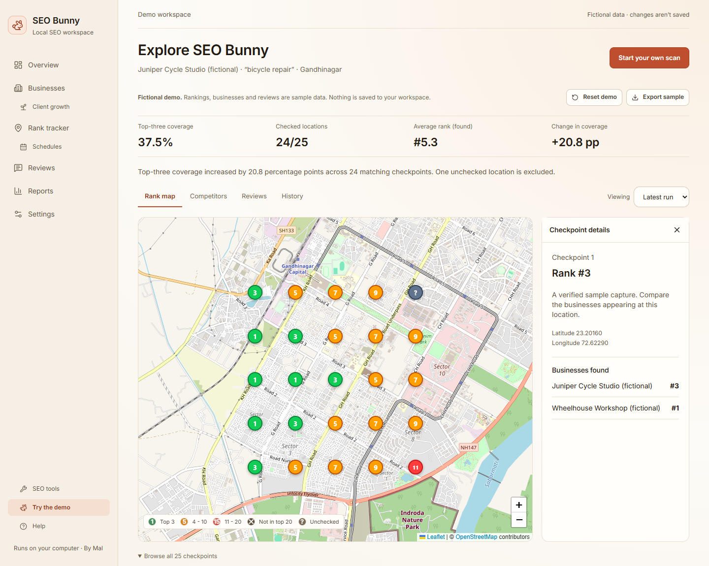
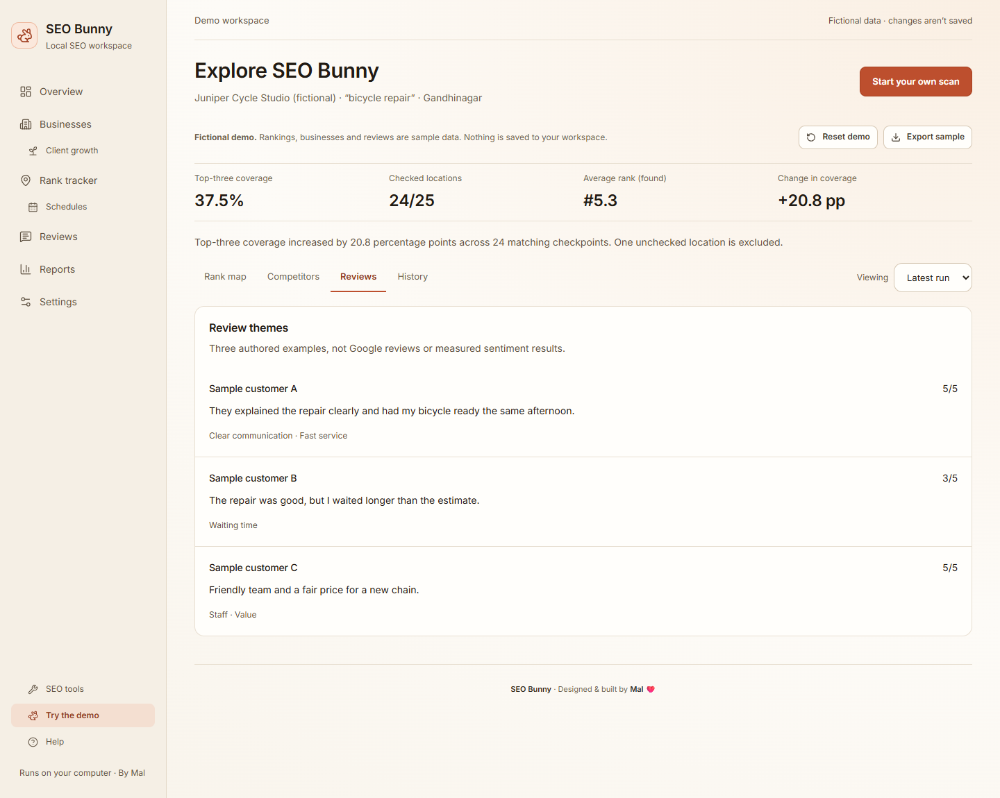

# SEO Bunny

**Local SEO & Maps Rank Tracker · Built by Malhar Jani**

I built SEO Bunny while working on local business websites and SEO. It checks
where a business appears across a map, compares competitors, and brings review
analysis and client work into one local workspace.

It runs on your computer with SQLite. You do not need an account to explore the
demo or run rank scans. Google Business Profile management is an optional setup.

The workspace includes a map-first report layout, a persistent business selector,
an overview of recent results and unchecked locations, and mobile checkpoint
inspection. Failed map tiles show a recoverable error while keeping ranking data
available. The interface uses a consistent cream and terracotta theme.



## Try it

Use Node.js **22.12 or newer** (Node 22 LTS recommended).

```sh
npm ci
npm run setup:local
npm run dev -- --hostname 127.0.0.1 --port 3210
```

Open **http://127.0.0.1:3210**. Choose **Try the demo** for a fictional business,
two example runs, competitor data, and authored review examples. The demo page
does not modify your saved workspace.

To explore in a separate disposable workspace:

```sh
npm run demo
```

Open **http://127.0.0.1:3211/demo**. This mode blocks API mutations and disables
background work. It uses a temporary SQLite file rather than your database.

For production mode, run `npm run build`, then double-click **Start SEO Bunny.cmd**
on Windows. The old launcher remains as a compatibility shortcut.

## What it does

- **Maps rank grids:** square, circular, neighborhood and postal grids, with
  checkpoint inspection, saved businesses, scheduling, and run history.
- **Coverage you can inspect:** failed checks and ambiguous older captures are
  separate from “not in the top 20.” Retry only failed/unknown points without
  deleting the original run.
- **Competitor reports:** coverage, ranking comparisons, geographic gaps, and a
  summary of change across matching verified checkpoints.
- **Review analysis:** collection coverage, saved runs, review themes, exports,
  and English sentiment analysis. Unsupported languages are labelled unassessed.
- **Client workspace:** notes, contacts, review-request QR codes, draft replies,
  and posts. Official publishing requires a connected Google manager account and
  explicit approval of the content.
- **Private backups and separate shareable reports:** workspace backups retain
  private data; the rank-report export excludes credentials, customer contacts,
  notes, settings, and review text.



## First scan

1. Save a business, or open **New rank scan** directly.
2. Enter a keyword and locate the business on the map. The initial map position
   is an example, so you must select or resolve your actual location.
3. Start with a 3 × 3 grid. Nine checkpoints usually need a few minutes; network
   conditions, browser setup, and retries affect duration.
4. Read the report summary and inspect individual pins. Retry unchecked points
   before interpreting coverage changes.

See the [walkthrough](docs/WALKTHROUGH.md) and [local setup](LOCAL-SETUP.md).

## Google integration and limitations

Rank scans and the fictional demo work without Google OAuth. Official location
imports, review synchronization, replies, and posts require **your own Google
Cloud project with Business Profile API access**, enabled APIs, and owner/manager
permissions. Connecting an account does not grant API approval.
[Google setup requirements](https://developers.google.com/my-business/content/prereqs)

Maps results vary with time, location, and Google changes. Browser collection can
fail or be blocked; this app cannot guarantee rankings or collection completeness.
Visibility and share-of-voice weights are modelled indicators, not measured
Google clicks or CTR. Compare the same keywords and checkpoints across runs.

The local server has no multi-user authentication. Bind it to **127.0.0.1**;
public hosting of the full app requires a separate security and tenancy design.
See [SECURITY.md](SECURITY.md).

## Stack and development

Next.js 16, React 19, TypeScript, Tailwind CSS, Prisma + SQLite, Playwright,
Leaflet, Recharts, and Electron. XLSX/PDF exports use ExcelJS and jsPDF.

| Command | Purpose |
| --- | --- |
| `npm test` | Regression tests with disposable databases and mocked Google calls |
| `npm run typecheck` | Check TypeScript |
| `npm run check:public` | Source preflight for common credentials/private files |
| `npm run build` | Build the web app |
| `npm run electron:dev` | Run the desktop shell |
| `npm run electron:build:win` | Build a Windows installer |
| `npm run electron:build:mac` | Build on macOS |

Pull requests run checks on Windows and Linux. Desktop installers should also be
tested on a clean machine; macOS signing/notarization requires the maintainer’s
Apple credentials. See [release checklist](docs/RELEASE.md).

Licensed under [MIT](LICENSE).
